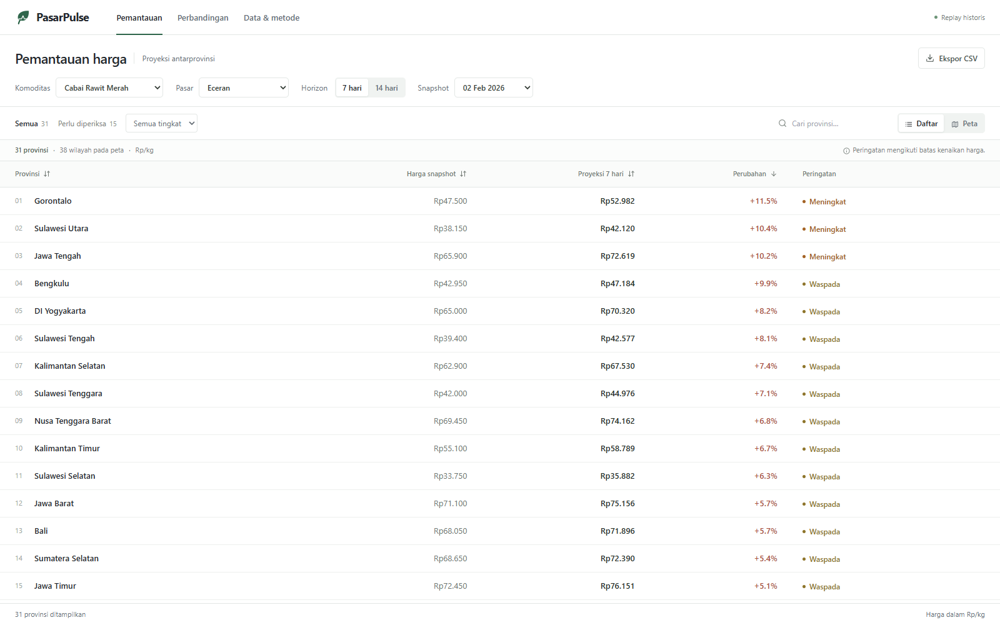
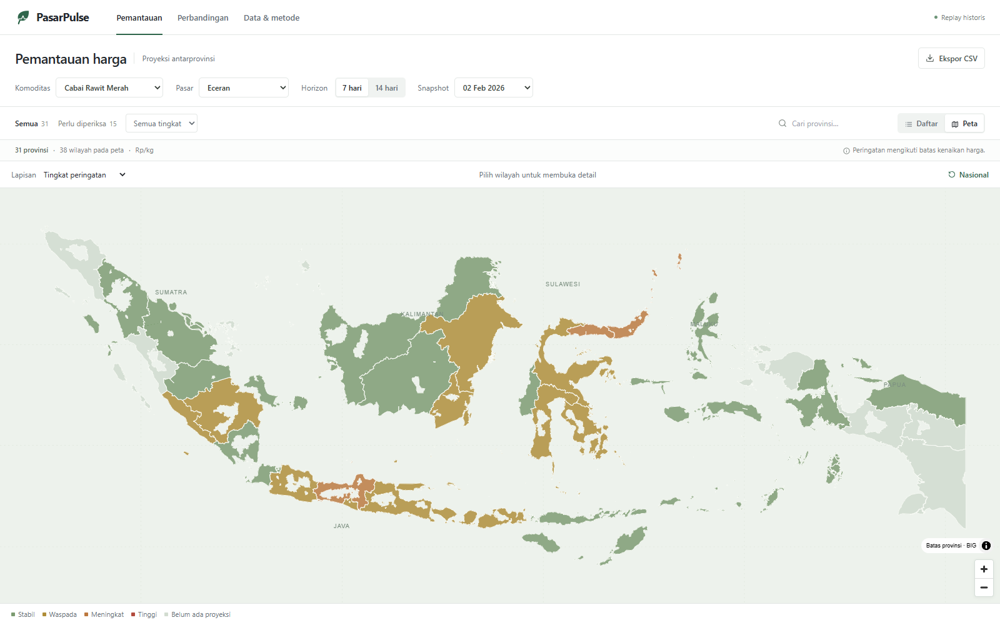
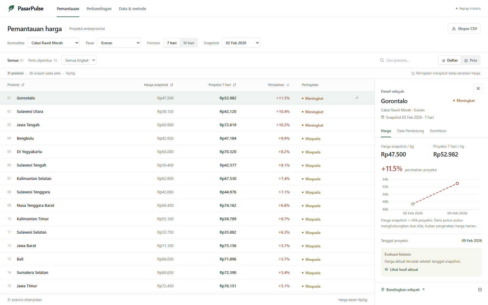

# PasarPulse

Food-price forecasting and provincial monitoring for Indonesian horticultural markets.
The product combines a Next.js workspace, a FastAPI artifact API, and saved
chronological forecasts. It runs in **Historical Replay** without loading model
weights or training during startup, filtering, map interaction, or explanation.

## Dashboard

Monitoring starts with a searchable, sortable province table. **List / Map**
views share the same filters and selection; a province inspector opens on demand.
Comparisons and data/methodology have separate workspaces. Warnings are review
thresholds over projected price increases, not probabilities or dispatch orders.



Screenshot: **2 February 2026 · Cabai Rawit Merah · retail · 7 days**.
The default application opens the latest available origin, not this example date.

<details>
<summary>Map, province detail, and mobile screenshots</summary>





[View the mobile workspace](docs/images/dashboard-mobile.png).

</details>

## Coverage

- **Commodities:** Bawang Merah, Cabai Merah Keriting, and Cabai Rawit Merah.
- **Market levels:** producer, wholesale, and retail.
- **Horizons:** 7 and 14 days.
- **Price archive:** 1 February 2024–31 July 2026; contextual acquisition starts
  1 January 2024 to construct lagged features.
- **Replay:** 3,893 forecasts over 279 eligible series and seven chronological
  origins, 2 February–17 July 2026.
- **Geography:** 34 province codes in the replay archive; 38 BIG province
  geometries for visualization. Coverage under an individual filter can be lower.

Sources: [`forecast_manifest.json`](demo_data/manifests/forecast_manifest.json),
[`DATA_BUNDLE_STATUS.md`](docs/DATA_BUNDLE_STATUS.md), and
[`data/dataset_summary.csv`](data/dataset_summary.csv).

## Modalities and data provenance

All modalities are converted into **tabular, time-aligned features**. Satellite
inputs are vegetation summaries over province proxy zones, rather than a CNN
processing images in the dashboard. Graph information is represented by derived
features, rather than a serving graph neural network.

| Modality | Provider | Information represented | Versioned artifacts |
|---|---|---|---|
| Price | PIHPS / Bank Indonesia | Daily province × commodity × market prices; lags, changes, rolling statistics. | `data/processed/price_daily.csv`<br>`data/processed/pihps_snapshot_manifest.csv` |
| Calendar | Versioned event calendar and deterministic date features | Weekday, seasonality, Ramadan/Eid, holidays, and event distances. | `data/manual/calendar_events.csv`<br>`data/processed/calendar_features.csv` |
| Weather | Copernicus ERA5-Land through CDS | Province-day temperature, precipitation, soil moisture, and solar radiation. | `data/processed/weather_daily.csv`<br>`data/processed/weather_metadata.json` |
| Agricultural production | BPS official annual tables | Production, harvested area, productivity, publication date, and observation age. | `data/processed/production_annual.csv`<br>`data/processed/bps_acquisition_manifest.csv` |
| Satellite vegetation | Sentinel-2 L2A; Earth Search / AWS Open Data mirror | NDVI, EVI, NDWI, anomalies, cloud/valid-pixel quality, and scene age. | `data/processed/satellite_features.csv`<br>`data/raw/sentinel2_asset_manifest.csv` |
| Markets and static connectivity | Kemendag/BIG official markets; OSM/Geofabrik | Market locations/schedules, roads, ports, ferries, adjacency, and candidate static connectivity. | `data/processed/official_market_province_summary.csv`<br>`data/processed/osm_province_transport_summary.csv`<br>`data/processed/province_graph_static.csv` |

**Dynamic graph context** is an additional feature family derived from rolling
90-day PIHPS price relationships: correlations, lead-lag relationships, neighbor
summaries, and graph age. Its artifact is
[`province_graph_dynamic.csv`](data/processed/province_graph_dynamic.csv).
It describes model-inferred price dependence, not observed commodity shipments
or causal propagation.

### Which modalities enter the selected forecast?

The richest feature set does not win at every horizon. The replay selects the
validated winner separately for each horizon:

| Data family | 7-day winner | 14-day winner |
|---|---|---|
| Price | Model input | Model input |
| Calendar | Model input | Model input |
| Weather | Model input | Additional context |
| Agricultural production | Model input | Additional context |
| Satellite vegetation | Model input | Additional context |
| Markets and static connectivity | Model input | Additional context |
| Dynamic price-dependence graph | Model input | Additional context |

- **7 days:** `LGBM_LOGRATIO__ALL_MODALITIES_DYNAMIC_GRAPH`, 115 features in the
  saved feature contract; pooled MAE **Rp3,538.49/kg**.
- **14 days:** `LGBM_LOGRATIO__PRICE_CALENDAR`, 46 features in the saved feature
  contract; pooled MAE **Rp5,308.47/kg**.

“Additional context” means it may be available in the evidence view; it does not
mean it influenced that model's forecast. Individual observations can still be
missing or stale. Availability, publication/effective dates, and observation age
remain visible and are gated against the forecast origin.

Authoritative inputs:
[`feature_contract.json`](results/multimodal_ablation/feature_contract.json),
[`forecast_manifest.json`](demo_data/manifests/forecast_manifest.json), and
[`availability_leakage_audit.json`](results/multimodal_ablation/availability_leakage_audit.json).

### Acquisition and availability details

- **PIHPS:** 270 monthly report snapshots, with 181,177 canonical observations
  reported by the acquisition validation. The replay's target-price source is PIHPS.
- **ERA5-Land:** 35,834 province-days, covering 38 provinces over 943 days.
  Daily weather context is replay-gated with a five-day publication lag.
- **BPS:** 342 province × commodity × year records for 2023–2025; 336 have both
  production and harvested area. Six source gaps remain missing.
- **Sentinel-2:** 786 scenes across 38 proxy zones. Five low-valid-pixel scenes
  retain their explicit quality flags. Imagery is regional vegetation context,
  not a direct measurement of chili/shallot production.
- **Markets and transport:** 625 official market points; 610 parsed operating
  schedules; 73 candidate static graph edges and 37,485 dynamic graph rows.
  DKI Jakarta has no point in the official-market source and retains that gap.
- **SP2KP:** 30 downloaded `.xlsx`-named payloads are archived, but all 30 rows in
  [`sp2kp_resource_manifest.csv`](data/processed/sp2kp_resource_manifest.csv)
  record parsing failure. They are not presented as the successful price source
  of the PIHPS replay.
- **BIG geometry:** used to locate and draw 38 provinces, not to invent forecasts
  for provinces absent from the replay.

Large ERA5 NetCDF files and the raw OSM PBF remain outside Git. The repository
stores normalized CSV/Parquet results, source manifests, hashes, and acquisition
code. The two large ready-panel CSVs and the research feature panel use Git LFS.

## Runtime, explanations, and interpretation

The API reads `demo_data/forecasts/forecast_snapshot.csv`,
`demo_data/evidence/evidence_snapshot.json`, and
`demo_data/geography/indonesia_provinces.geojson`. Filtering does not perform
inference or fetch upstream providers. Missing snapshots resolve to **Benchmark
Only**, and missing province rows have an explicit empty state.

Saved native LightGBM contributions are available in
[`results/dashboard_xai/`](results/dashboard_xai/). The manifest records
`native_lightgbm_pred_contrib`, 3,893 explained forecasts, and a maximum
reproduction difference below Rp0.00005. These are saved log-ratio prediction
drivers, not causal effects, rupiah contributions, confidence, TimeSHAP, or GNN
explanations. The dashboard does not run their offline generation script.

Later realized prices are revealed only in historical evaluation. They never
enter warning levels, province rankings, comparisons, CSV exports, or Copilot
context. Price-rise thresholds are configurable at 5%, 10%, and 15%; they are
product rules, not model probabilities or regulatory limits. Shock probabilities,
propagation predictions, calibrated uncertainty intervals, and the proposed
TFT/CNN/GNN architecture are not claimed as serving outputs.

## Run the dashboard

```bash
git clone https://github.com/Ditt-A/pasarpulse.git
cd pasarpulse
docker compose up --build
```

Open `http://localhost:3000`. Docker packages the application, replay data,
benchmarks, and saved forecast contributions; it does not package training weights
or execute research training. For a Python/Node setup, see
[README_DEPLOYMENT.md](README_DEPLOYMENT.md).

The optional Gemini assistant reads `PASARPULSE_LLM_API_KEY` from an uncommitted
environment or deployment secret store. Without it, monitoring and comparisons
remain usable, and the assistant reports its unavailable state. No generated
fallback answer is substituted.

For the full large research panels, install Git LFS and run `git lfs pull`.
Those panels are not required to serve the lightweight replay workspace.

See [dashboard interactions and typography](docs/DASHBOARD_UX.md) and the
[implementation audit](docs/IMPLEMENTATION_AUDIT.md). The archive's older
implementation audit predates the added native contribution artifacts; the
current XAI manifest and serving code are authoritative for those outputs.

## Research archive

The sections below retain the original notebook, experiment families, and saved
research scores. Their result families are distinct from the selected replay
models described above.

## Main notebook

- `notebooks/PasarPulse_A100_Research_Notebook.ipynb`

The notebook is executed and follows the research-paper structure from title page
through references. Its model section includes the actual feature construction,
chronological split logic, LightGBM and CatBoost training functions, seven-origin
finalist execution, fold metrics, explainability checks, and deployment-shaped
export. The larger 120-configuration search is reported from its saved A100
artifacts.

The compact finalist source is also checked in at
`experiments/pasarpulse_notebook_finalist.py`; its implementation is expanded into
the visible model subsections when the notebook is built.

## Data and model archive

The repository includes the complete reproducibility archive used by the A100
runs:

- `data/`: raw PIHPS/SP2KP/BPS inputs, processed price/calendar/production
  tables, ready model panels, and GeoJSON reference layers.
- `reports/` and `results/`: baseline, architecture-search, specialist,
  meta-router, OOF, feature-importance, and holdout artifacts.
- `models/`, `experiments/`, `pipeline/`, and `src/`: model and acquisition
  source code.
- `models/weights/`: deployable full-data LightGBM boosters for the winning
  seven-day and fourteen-day log-ratio experts, with their feature and
  categorical-mapping manifest.
- `model_runs/`: full parent-run outputs and architecture-sweep artifacts.

The two large ready-panel CSVs and the 75 MB model feature panel use Git LFS.
Credentials, virtual environments, caches, and temporary process files are
not included.

## Experiment summary

- 120 architecture configurations screened
- 7 chronological rolling forecast origins
- 7-day and 14-day horizons
- commodities: Bawang Merah, Cabai Merah Keriting, Cabai Rawit Merah
- market levels: producer, wholesale, retail

## Validated headline results

| Model | Horizon | MAE | WAPE |
|---|---:|---:|---:|
| ARIMA reference | 7 days | Rp3,731.69/kg | — |
| Raw CatBoost GPU log-ratio | 7 days | Rp3,581.00/kg | — |
| Leakage-safe commodity × market grid blend | 7 days | Rp3,454.11/kg | — |
| LightGBM log-ratio | 7 days | Rp3,275.46/kg | — |
| CatBoost commodity × market specialist | 7 days | Rp3,371.66/kg | 7.27% |
| CatBoost commodity × market specialist | 14 days | Rp4,858.38/kg | 10.44% |
| Prior-fold-only soft-error meta blend | 7 days | Rp3,495.79/kg | — |
| Prior-fold-only error router | 14 days | Rp4,952.64/kg | — |
| Best late-origin ensemble | 7 days | Rp3,642.35/kg | — |
| Best late-origin ensemble | 14 days | Rp5,004.57/kg | — |

The executed compact finalist check in the notebook produced LightGBM log-ratio
MAE Rp3,638.02/kg at 7 days and Rp5,464.92/kg at 14 days over the same seven
origins. The notebook also reports the visible CatBoost and inverse-MAE blend
outputs in `results/finalist_pooled_metrics.csv`. These values are a
reproducibility check for the visible training loop, not a replacement for the
stronger saved A100 architecture-search scores above.

## Completed six-modality A100 ablation

The repository also contains a separate, fully executed chronological ablation
using the merged price, calendar, ERA5-Land weather, BPS production, Sentinel-2
vegetation, official-market/static-graph, and rolling price-dependence graph
features. It evaluates the implemented tree models only; the proposed
TFT/CNN/GNN architecture is not claimed to be trained.

| Result | Horizon | Pooled MAE | Rows | Origins |
|---|---:|---:|---:|---:|
| Best ablation: LightGBM log-ratio + all modalities + dynamic graph | 7 days | Rp3,538.49/kg | 1,946 | 7 |
| Best ablation: LightGBM log-ratio + price + calendar | 14 days | Rp5,308.47/kg | 1,947 | 7 |
| Persistence reference | 7 days | Rp3,689.08/kg | 1,946 | 7 |
| Persistence reference | 14 days | Rp5,780.25/kg | 1,947 | 7 |

Against the matching persistence rows, the best ablation improves pooled MAE by
4.08% at 7 days and 8.16% at 14 days. The all-modality dynamic-graph variant is
best at 7 days, but not at 14 days; the 14-day result is therefore selected by
the validation table rather than assumed from the richer feature set. The full
fold, OOF, feature-contract, availability audit, and result validation files
are in `results/multimodal_ablation/`.

## Scope

The 120-model sweep and the finalist retraining ran as GPU Python jobs on an
NVIDIA A100. The notebook does not falsely claim to retrain every search
configuration interactively; it does show and execute the finalist training loop.


## Upstream provenance

Imported from [ElFariss/datathon-2026](https://github.com/ElFariss/datathon-2026),
source commit `0d5b372769c008febe92fddf6ef4594509ca8570`. The initial import
preserved all 694 tracked files. Dashboard and documentation changes are
maintained in this repository; saved research data and metric outputs remain
unchanged.
